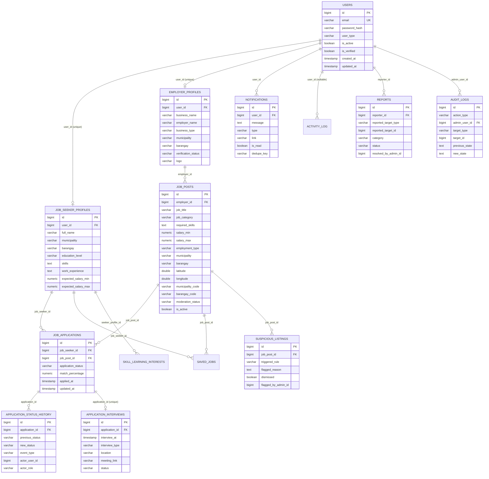

# Database Documentation

**Job & Skills Matching (JSM) — final release**
Source of truth: Flyway migrations `backend/src/main/resources/db/migration/V1…V9` and the JPA entities in `backend/src/main/java/com/jobskills/model`. The application runs with `ddl-auto: validate`, so this schema is enforced, not merely suggested.

---

## 1. Overview

| Property | Value |
| --- | --- |
| Engine | PostgreSQL (production: Supabase) |
| Schema | `enuv` (created by Flyway; `default_schema: enuv`) |
| Migrations | `V1` … `V9`, applied automatically at startup |
| Migration safety | `clean-disabled: true`, `baseline-on-migrate: true`, all migrations additive |
| IDs | `BIGSERIAL` → `Long` |
| Timestamps | `TIMESTAMP` (no time zone) |
| Enumerations | Stored as `VARCHAR` with JPA `@Enumerated(EnumType.STRING)` |
| Binary uploads | Stored in the database (`uploaded_files`), not on disk |

## 2. Entity relationship diagram

## 3. Tables

### 3.1 `users` (V1)

| Column | Type | Notes |
| --- | --- | --- |
| `id` | BIGSERIAL | PK |
| `email` | VARCHAR(255) | **UNIQUE**, NOT NULL |
| `password_hash` | VARCHAR(255) | BCrypt hash, never returned by the API |
| `user_type` | VARCHAR(50) | `JOB_SEEKER`, `EMPLOYER`, `ADMIN` |
| `is_active` | BOOLEAN | `false` = suspended; blocks login **and** existing tokens |
| `is_verified` | BOOLEAN | Kept for legacy employer verification; Phase 6 adds `verification_status` |
| `created_at`, `updated_at` | TIMESTAMP | |

### 3.2 `job_seeker_profiles` (V1)

One row per job-seeker account (`user_id` UNIQUE, `ON DELETE CASCADE`). Matching-relevant fields: `full_name`, `contact_number`, `municipality` (enum), `barangay`, `education_level`, `course_field`, `work_experience` (free text), `certifications`, `employment_type_preference`, `preferred_work_schedule`, `availability`, `expected_salary_min`, `expected_salary_max`, `profile_photo`, `skills` (comma/semicolon separated free text), `created_at`.

### 3.3 `employer_profiles` (V1, extended by V8)

One row per employer account (`user_id` UNIQUE). Fields: `business_name`, `employer_name`, `contact_number`, `business_type` (enum), `municipality`, `barangay`, `business_address`, `business_description`, `logo`, `created_at`, and from V8 `verification_status` (`UNVERIFIED` default, `PENDING`, `VERIFIED`, `REJECTED`, `NEEDS_INFORMATION`).

### 3.4 `job_posts` (V1, extended by V4 and V8)

| Column | Notes |
| --- | --- |
| `employer_id` | FK → `employer_profiles(id)` `ON DELETE CASCADE` |
| `job_title`, `job_description`, `responsibilities` | Required |
| `job_category` | 20-value enum |
| `required_skills` | Free text list, parsed by the matching engine |
| `education_requirement`, `experience_requirement`, `certifications` | Free text / enum |
| `salary_min`, `salary_max` | `DECIMAL(10,2)`, nullable ("negotiable") |
| `employment_type`, `work_schedule`, `available_positions` | |
| `municipality` (required), `barangay`, `job_location` | Coverage enforced by the `Municipality` enum |
| `latitude`, `longitude`, `municipality_code`, `barangay_code` | Added by V4; the map plots a post only when the pin is complete |
| `moderation_status` | Added by V8: `PENDING_REVIEW` (default), `APPROVED`, `CHANGES_REQUESTED`, `REJECTED` |
| `is_active` | Open/closed and soft visibility flag |
| `created_at`, `updated_at` | |

Constraint `job_posts_pin_complete` (V4) guarantees coordinates and PSGC codes are either all present or all absent, so a half-pinned post cannot exist.

### 3.5 `job_applications` (V1, V6)

`job_seeker_id` and `job_post_id` FKs, `applied_at`, `application_status` (V6 default `SUBMITTED`; `REVIEWING`, `SHORTLISTED`, `INTERVIEW`, `ACCEPTED`, `REJECTED`, `WITHDRAWN`), `match_percentage` snapshot at application time, `updated_at` (V6). **`UNIQUE (job_seeker_id, job_post_id)`** makes a duplicate application impossible at the database level.

### 3.6 `application_status_history` (V6)

Append-style timeline: `application_id`, `previous_status`, `new_status`, `event_type` (status change, interview scheduled/rescheduled/cancelled, withdrawal, submission), `actor_user_id`, `actor_role`, `actor_name`, `message`, `created_at`. V6 backfilled one row per pre-existing application.

### 3.7 `application_interviews` (V6)

One interview per application (`application_id` UNIQUE): `interview_at`, `interview_type`, `location`, `meeting_link`, `instructions`, `employer_message`, `status`, `created_by`, timestamps.

### 3.8 `notifications` (V1, extended by V6)

`user_id` FK, `message`, `is_read`, `created_at`, plus V6 columns `title`, `type`, `link`, `reference_type`, `reference_id`, `read_at`, `dedupe_key` with `UNIQUE (user_id, dedupe_key)` — the same event cannot notify the same user twice.

### 3.9 `saved_jobs` (V1)

`job_seeker_id`, `job_post_id`, `saved_at`, `UNIQUE (job_seeker_id, job_post_id)`.

### 3.10 `uploaded_files` (V2)

Profile pictures and logos are stored in the database: `filename` (unique), `content_type`, `size_bytes`, `data` (binary), `created_at`. Served by `GET /uploads/{filename}`. Survives redeploys and free-tier spin-downs without a persistent volume.

### 3.11 `activity_log` (V1)

Legacy general activity record: `user_id` (nullable, `ON DELETE SET NULL`), `action_type`, `description`, `ip_address`, `user_agent`, `created_at`.

### 3.12 `learning_resources` (V7)

Admin-managed catalogue: `skill_name`, `skill_key`, `title`, `provider`, `url`, `cost`, `is_free`, `is_online`, `duration`, `description`, `availability`, `verified_at`, `is_active`, timestamps.

### 3.13 `skill_learning_interests` (V7)

`seeker_profile_id`, `skill_name`, `skill_key`, `created_at`, `UNIQUE (seeker_profile_id, skill_key)`. Used by skills-demand analytics as recorded seeker interest.

### 3.14 `reports` (V8)

`reporter_id` FK, `reported_target_type` (`JOB_POSTING`, `EMPLOYER`, `USER`), `reported_target_id`, `category` (`FRAUD_OR_SCAM`, `MISLEADING_INFORMATION`, `FAKE_EMPLOYER`, `DUPLICATE_LISTING`, `WRONG_LOCATION`, `INAPPROPRIATE_CONTENT`, `OTHER`), `description`, `status` (`OPEN`, `UNDER_REVIEW`, `RESOLVED`, `DISMISSED`), `admin_notes`, `resolved_by_admin_id` (`ON DELETE SET NULL`), `resolved_at`, `created_at`, `is_duplicate`.

### 3.15 `suspicious_listings` (V8)

`job_post_id` FK (`ON DELETE CASCADE`), `flagged_reason`, `triggered_rule`, `status`, `flagged_at`, `dismissed`, `dismissed_at`, `dismiss_reason`, `flagged_by_admin_id`. The partial unique index `uq_suspicious_listing_open_rule (job_post_id, triggered_rule) WHERE dismissed = FALSE` means a rule cannot flag the same listing twice while the flag is open, but a corrected repost can be flagged again.

### 3.16 `audit_logs` (V8)

Append-only administrator trail: `action_type` (e.g. `EMPLOYER_VERIFIED`, `JOB_POST_APPROVED`, `REPORT_RESOLVED`, `USER_SUSPENDED`), `admin_user_id` FK, `target_type`, `target_id`, `reason`, `previous_state`, `new_state`, `created_at`. No route updates or deletes an entry.

### 3.17 `rate_limit_counters` (V9)

Operational table (no JPA entity): `bucket_key` PK `VARCHAR(200)`, `window_start` BIGINT (epoch second), `hits` INTEGER, `updated_at` TIMESTAMP. One upsert per limited request; rows older than 24 hours are removed opportunistically.

## 4. Relationships and cardinality

| Relationship | Cardinality | Delete rule |
| --- | --- | --- |
| `users` → `job_seeker_profiles` | 1 : 0..1 | CASCADE |
| `users` → `employer_profiles` | 1 : 0..1 | CASCADE |
| `employer_profiles` → `job_posts` | 1 : N | CASCADE |
| `job_posts` → `job_applications` | 1 : N | CASCADE |
| `job_seeker_profiles` → `job_applications` | 1 : N | CASCADE |
| `job_applications` → `application_status_history` | 1 : N | (kept while application exists) |
| `job_applications` → `application_interviews` | 1 : 0..1 | one row per application |
| `job_posts` → `suspicious_listings` | 1 : N | CASCADE |
| `users` → `reports` | 1 : N | restricted |
| `users` → `audit_logs` | 1 : N | restricted (an admin with history cannot be deleted silently) |

Moderation relationships: an employer **profile** carries `verification_status`; each **job post** carries its own `moderation_status`; a **report** points at a target by `(type, id)` rather than a foreign key, because one report table covers posts, employers and users; a **suspicious listing** always points at a real post and disappears with it.

## 5. Indexes

| Index | Table | Purpose |
| --- | --- | --- |
| `idx_job_posts_municipality`, `idx_job_posts_category`, `idx_job_posts_active`, `idx_job_posts_employer` | `job_posts` | Listing and filters |
| `idx_job_posts_active_created`, `idx_job_posts_active_municipality` (V5) | `job_posts` | Default search order, map counts |
| `idx_job_posts_employment_type`, `idx_job_posts_salary_max` (V5) | `job_posts` | Filters and ranges |
| `idx_job_posts_barangay_code`, `idx_job_posts_municipality_code` (V4) | `job_posts` | Geographic queries |
| `idx_job_posts_moderation_status` (V8) | `job_posts` | Admin review queue |
| `idx_job_applications_status`, `idx_job_applications_job`, `idx_applications_seeker` (V1, V5/V6) | `job_applications` | Applicant lists, dashboards |
| `unique_application (job_seeker_id, job_post_id)` | `job_applications` | Duplicate prevention |
| `idx_job_seeker_municipality`, `idx_seeker_profiles_barangay` | `job_seeker_profiles` | Matching and coverage stats |
| `idx_employer_municipality` | `employer_profiles` | Geographic stats |
| `idx_notifications_user`, `idx_notifications_user_read`, `idx_notifications_user_created`, `uq_notifications_user_dedupe` | `notifications` | Inbox, unread badge, dedupe |
| `idx_app_history_application`, `idx_app_history_created` | `application_status_history` | Timeline |
| `idx_interviews_application` | `application_interviews` | Interview lookup |
| `idx_reports_status`, `idx_reports_target`, `idx_reports_reporter` | `reports` | Queues and stats |
| `idx_suspicious_listings_job`, `idx_suspicious_listings_rule`, `uq_suspicious_listing_open_rule` | `suspicious_listings` | Detection and review |
| `idx_audit_logs_created`, `idx_audit_logs_admin`, `idx_audit_logs_target` | `audit_logs` | Audit browsing |
| `idx_learning_resources_skill`, `idx_learning_resources_active`, `idx_learning_interests_seeker` | V7 tables | Skills guidance |
| `idx_rate_limit_updated` | `rate_limit_counters` | Stale-counter cleanup |

## 6. Migration history

| Version | File | Change | Data impact |
| --- | --- | --- | --- |
| V1 | `V1__create_tables.sql` | Core schema: users, profiles, posts, applications, saved jobs, notifications, activity log; base indexes; seeded admin placeholder | Inserts one admin row if absent |
| V2 | `V2__store_uploads_in_database.sql` | `uploaded_files` | None |
| V3 | `V3__add_dummy_accounts.sql` | Sample accounts for local development | Inserts demo rows |
| V4 | `V4__add_job_coordinates.sql` | Pin columns, PSGC codes, `job_posts_pin_complete` constraint, two indexes | Existing posts stay unpinned (nullable) |
| V5 | `V5__matching_indexes.sql` | Search indexes on posts and applications | None |
| V6 | `V6__application_tracking_and_notifications.sql` | Status vocabulary (`APPLIED→SUBMITTED`, `UNDER_REVIEW→REVIEWING`), `updated_at`, history table + backfill, interviews table, notification columns, dedupe index | Rewrites two status values, backfills one history row per application |
| V7 | `V7__skills_gap_and_learning_resources.sql` | `learning_resources`, `skill_learning_interests` | None |
| V8 | `V8__admin_moderation.sql` | `verification_status`, `moderation_status` (+ backfill `APPROVED` for existing posts), `reports`, `suspicious_listings`, `audit_logs` | Backfills verification for previously verified employers and moderation status for existing posts; deletes nothing |
| V9 | `V9__rate_limit_counters.sql` | `rate_limit_counters` + index | None |

A fresh database was verified end-to-end in Phase 7: V1–V8 applied in 241 ms and `ddl-auto=validate` passed. V9 was applied to the development database during Phase 8 and validated the same way.

## 7. Data-integrity rules the application relies on

1. **No duplicate applications** — unique constraint plus a pre-insert existence check.
2. **No duplicate open flag per rule** — partial unique index; detection is re-runnable.
3. **No duplicate notifications** — `(user_id, dedupe_key)`.
4. **All-or-nothing pin** — `job_posts_pin_complete` CHECK constraint.
5. **Moderation status is never null** — default `PENDING_REVIEW`, NOT NULL.
6. **Suspension is a flag, not a delete** — `is_active = false` keeps applications, history and audit intact.
7. **Audit entries are immutable through the API** — only inserts exist.
8. **Schema is validated at startup** — entity/table drift fails fast.
