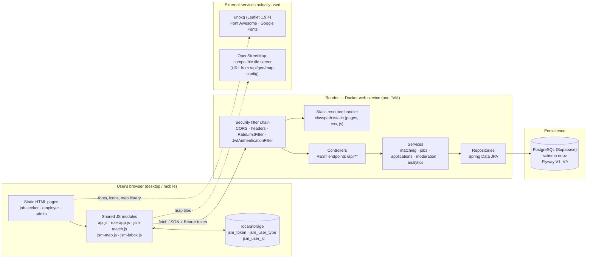
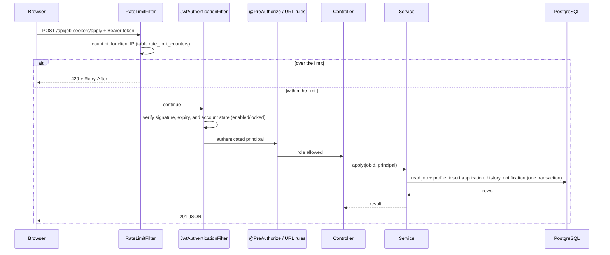
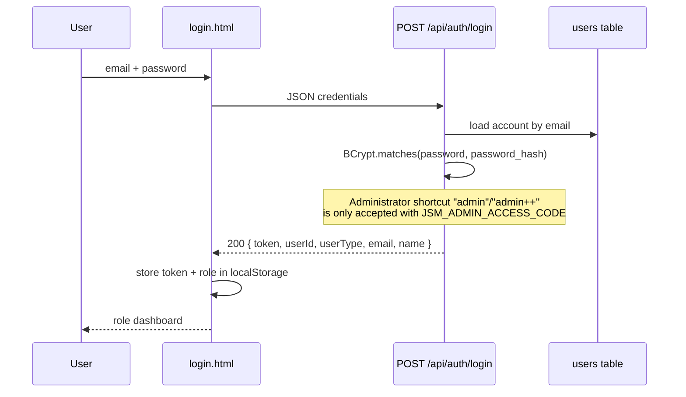
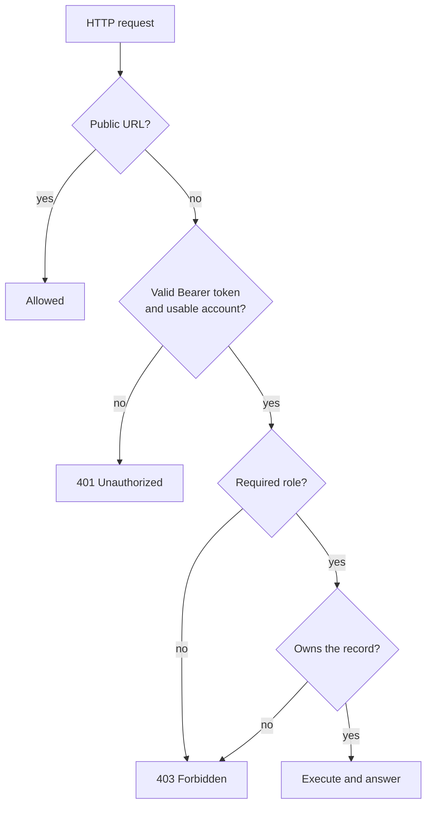
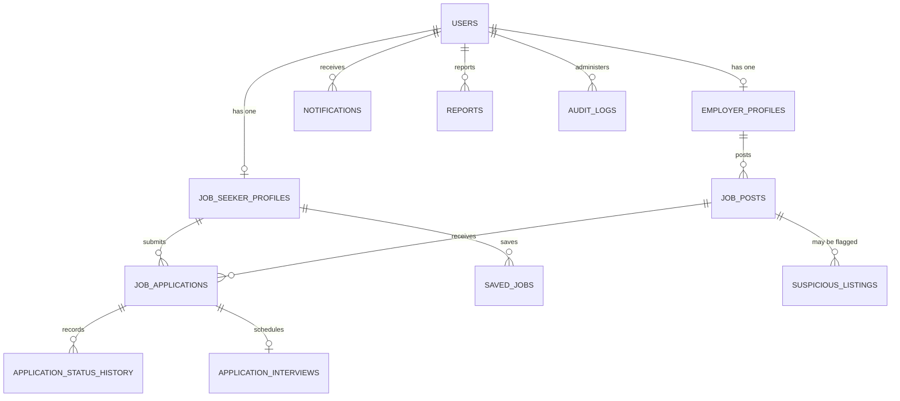
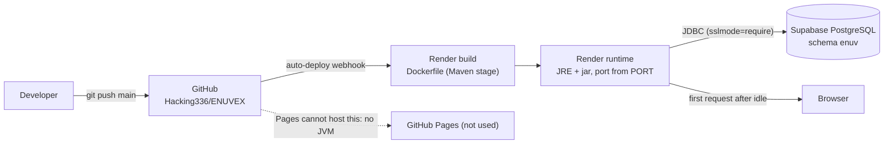
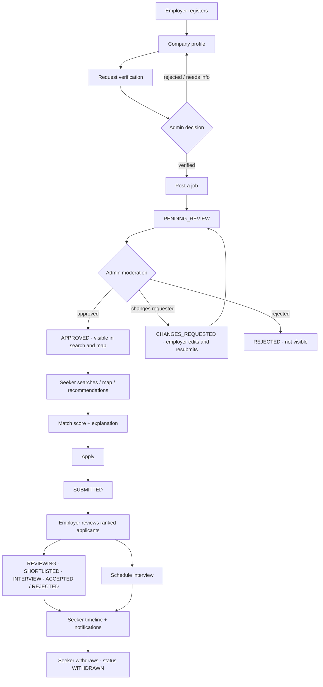
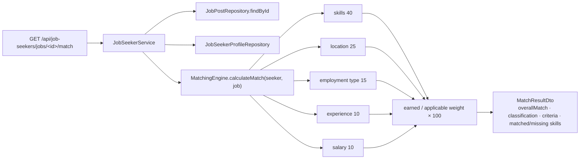
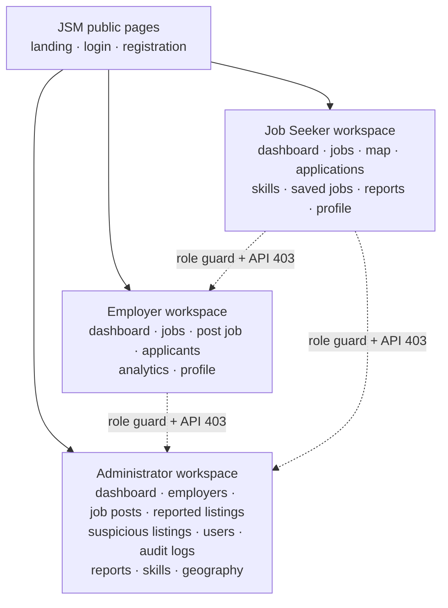

# System Architecture

**Job & Skills Matching (JSM) — final release documentation**
All components below exist in the repository; nothing here is planned or hypothetical.

---

## 1. Architectural style

JSM is a **single deployable Spring Boot application** with a classic layered backend and a static, JavaScript-driven frontend served by the same process:

- One JVM serves the REST API under `/api/**`, the upload endpoint `/uploads/**`, and every HTML page (`/`, `/job-seeker/*`, `/employer/*`, `/admin/*`).
- The frontend has **no build step**: plain HTML, CSS and JavaScript files copied into the jar by Maven and served from the classpath.
- All state lives in PostgreSQL. The application is stateless apart from that database, so it can be restarted or replaced at any time without losing data.

---

## 2. Backend architecture

Package root: `com.jobskills` (artifact `job-skills-matching-system`, version 1.0.3).

| Package | Responsibility | Examples |
| --- | --- | --- |
| `config` | Security chain, JWT filter, CORS, user details, static-asset cache filter, OpenAPI | `SecurityConfig`, `JwtAuthenticationFilter`, `CustomUserDetailsService` |
| `ratelimit` | Persistent fixed-window rate limiting | `RateLimiter`, `RateLimitFilter`, `JdbcRateLimitStore` |
| `controller` | HTTP mapping and authorization annotations only | `JobController`, `EmployerController`, `AdminController`, `GeoController` |
| `service` | Business rules, transactions, cross-entity orchestration | `UserService`, `JobService`, `MatchingEngine`, `ApplicationService`, `EmployerAnalyticsService`, `SuspiciousListingService`, `GeoService`, `NotificationService` |
| `repository` | Spring Data JPA interfaces, derived queries, JPQL | `JobPostRepository`, `JobApplicationRepository`, `AuditLogRepository` |
| `model` | JPA entities and enums | `User`, `JobPost`, `JobApplication`, `Report`, `AuditLog` |
| `dto` | Request/response shapes, never entities on write paths | `JobResponse`, `MatchResultDto`, `AdminJobPostDto` |
| `exception` | Uniform error responses | `GlobalExceptionHandler`, `ResourceNotFoundException` |

Layer rules actually followed in the code:

- Controllers contain no business logic beyond argument handling and small mapping helpers.
- **One** matching implementation (`MatchingEngine`) is used by seeker recommendations, job search, employer applicant lists and admin statistics, so a percentage shown in two places cannot disagree.
- Authorization is enforced twice: URL rules in `SecurityConfig` and method-level `@PreAuthorize` on controller classes (`@PreAuthorize("hasRole('ADMIN')")`, `"hasRole('EMPLOYER')"`, `"hasRole('JOB_SEEKER')"`, `"isAuthenticated()"`).
- Entities never carry passwords out: `User.passwordHash` is never serialised because the profile endpoints map to DTOs or projections.

### Request flow for a protected call

---

## 3. Frontend architecture

- **Pages**: 33 HTML files — 5 shared/root (`index.html`, `login.html`, `register.html`, `layout.html`, role registration pages) plus `job-seeker/` (14), `employer/` (9) and `admin/` (11).
- **Shared CSS**: `assets/css/style.css`, `enuvex-role.css` (app shell: sidebar, top bar, cards, tables), `auth.css`, `landing.css`, `jsm-map.css`, `assets/brand/brand.css`. Each role directory also has its own `enuvex-app.css` and `enuvex-app.js` shell (sidebar, search, notification bell, session guard).
- **Shared JavaScript**:

| File | Role |
| --- | --- |
| `assets/js/api.js` | `ApiClient` — base URL, JSON, Bearer token, 401 handling |
| `assets/js/role-app.js` | Session guard, role-aware navigation, user chip, formatting helpers, image URLs |
| `assets/js/jsm-match.js` | Rendering of match badges, criteria and explanations |
| `assets/js/jsm-map.js` | Single Leaflet implementation: tiles from `/api/geo/map-config`, boundaries, clustering, only posts with confirmed coordinates |
| `assets/js/jsm-inbox.js` | Notification bell, unread count, dropdown |
| `assets/js/main.js`, `landing.js` | Landing page behaviour |
| `assets/js/layout.js` | Shared layout helpers |

- **Session**: the token and the user's role/id are stored in `localStorage` (`jsm_token`, `jsm_user_type`, `jsm_user_id`). `role-app.js` redirects to `login.html` when the role does not match the page. This is a UX guard — the API is the enforcement point.
- **Rendering**: each page renders from JSON with template strings and explicit `esc()` helpers; no framework and no bundler.
- **PWA assets**: `manifest`/icons and `mobile/` assets exist; the application is installed-optional, not a store app.

---

## 4. Authentication

- Tokens are signed with JJWT HS256 using `JWT_SECRET` (no default — the app refuses to start without it). Expiry is `JWT_EXPIRATION_MS`, default one hour.
- Every request re-reads the account through `CustomUserDetailsService`; a suspended, locked or expired account is rejected even if its token is still valid.
- Passwords are hashed with `BCryptPasswordEncoder` (cost 10).
- There is **no refresh-token endpoint** and no server-side session store: expiry means the user signs in again.

## 5. Authorization

| Actor | Rule in code | Effect |
| --- | --- | --- |
| Anonymous | permitted URLs only | Public pages, `/api/health`, `/api/auth/**`, enums (`/api/municipalities`, `/api/categories`, `/api/business-types`), `GET /api/geo/**`, `GET /api/jobs/**`, `/uploads/**`, API docs |
| Any signed-in user | `anyRequest().authenticated()` | Profiles, notifications, applications, own reports |
| `JOB_SEEKER` | `@PreAuthorize("hasRole('JOB_SEEKER')")` on `JobSeekerController` | Seeker profile, matching, apply, skills, saved jobs |
| `EMPLOYER` | `@PreAuthorize("hasRole('EMPLOYER')")` on `EmployerController` | Company profile, job posting, applicant review, status changes, interviews, analytics |
| `ADMIN` | `@PreAuthorize("hasRole('ADMIN')")` on `AdminController`, `AdminGeoController`, `AdminMatchingController`, `ReportsController` | Verification, moderation, reports, suspicious listings, users, audit logs |

Ownership is checked in the service layer as well: an employer can only read applicants, analytics and skills analysis for its own posts, and a seeker can only read its own applications. A foreign record answers **403** (cross-tenant read) rather than leaking existence.

---

## 6. Database

- PostgreSQL, schema `enuv`, one Hikari pool (max 5 connections) sized for the free hosting tier.
- Hibernate runs with `ddl-auto: validate`, so the entities must match the schema Flyway produced; a mismatch fails startup instead of silently altering tables.
- Flyway applies `classpath:db/migration` (V1–V9) at startup and is idempotent; `clean-disabled: true` makes an accidental wipe impossible through the application.
- Full table, key and index detail: `DATABASE_DOCUMENTATION.md`.

---

## 7. API communication

- All calls are JSON over HTTPS under `/api`; multipart/form-data only for registration (optional photo/logo) and nothing else.
- Requests carry `Authorization: Bearer <token>`; responses are JSON, with `Cache-Control: no-cache, no-store` on API traffic.
- Errors share one shape: `{"error": "...", "status": 400}` with the correct status code (400 validation, 401 anonymous, 403 role/ownership, 404 unknown id, 405 wrong method, 409 conflict, 429 rate limited, 500 unexpected).
- CORS is resolved per request: a browser origin is accepted when it is the same host the request arrived on, plus the fixed origins (production domain, custom domain, localhost and the Capacitor WebView origins). This keeps same-host POSTs working on any deployment hostname without opening the API to unrelated sites.
- Endpoint reference: `API_DOCUMENTATION.md`.

---

## 8. Hosting and deployment

- The Docker build context is the repository root because the POM copies `*.html`, `assets/`, `job-seeker/`, `employer/`, `admin/` into the jar.
- Render injects `PORT`; the app listens on it. Health check path `/api/health` now performs a real readiness query and answers 503 when the database is unreachable.
- Environment variables (names only): `DB_URL`, `DB_USERNAME`, `DB_PASSWORD`, `JWT_SECRET`, optional `JWT_EXPIRATION_MS`, `JSM_ADMIN_ACCESS_CODE`, `JSM_MAP_*`, `JSM_RATE_LIMIT_*`, `PORT`.
- Deployments are additive: Flyway runs before the app serves traffic, and every migration in the repository is non-destructive.

## 9. External services actually used

| Service | Purpose | Configuration | Failure behaviour |
| --- | --- | --- | --- |
| Supabase PostgreSQL | Production database | `DB_URL` with `currentSchema=enuv` | App answers 503 on health; pages still load |
| OpenStreetMap-compatible tile server | Map tiles | `JSM_MAP_TILE_URL`, attribution, zoom and centre via `/api/geo/map-config` | Map shows grey tiles; lists still work |
| unpkg | Leaflet + marker cluster scripts/CSS | Pinned versions 1.9.4 / 1.5.3 in `jsm-map.js` | Map does not initialise; job lists unaffected |
| Font Awesome CDN, Google Fonts | Icons, Poppins/Inter | CDN links in page heads | Falls back to system fonts/icons |
| Render | Hosting and TLS | `Dockerfile`, auto-deploy from `main` | n/a |

No analytics, payment, email, SMS or AI service is integrated.

---

## 10. Main workflows

### Matching request path

## 11. Role-based access structure

Every workspace page is a static file, so the browser can load it; the data behind it is protected by the API rules in section 5. A seeker who types an admin URL sees the page shell, and every request it makes answers 401/403.
